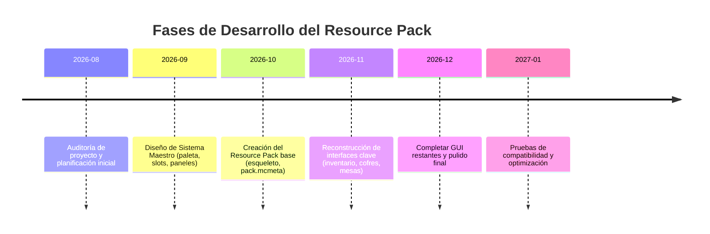

# Design System — Master Steel

> Artefacto requerido por Flujo §2. Reutilizable, previo a cualquier GUI.

## 1. Paleta Relacional (Fórmulas + Hex)

Base **B = #909398** (144,147,152). Todo deriva por L en HSL.

| Token | Fórmula | Hex | RGB | Delta L vs B |
|-------|---------|-----|-----|--------------|
| `steel-base` | B | #909398 | 144,147,152 | 0 |
| `steel-highlight` | B +11.0% | #ACB0B4 | 172,176,180 | +11.0% |
| `steel-shadow` | B -12.5% | #707378 | 112,115,120 | -12.5% |
| `steel-outer` | B -25.3% | #4E5054 | 78,80,84 | -25.3% |
| `slot-base` | B -18.8% → tuneado -17% | #606368 → #63666B | 99,102,107 | -18.8%→-17% |
| `slot-shadow` | slot-base -12.5% | #404348 | 64,67,72 | — |
| `slot-highlight` | slot-base +15.7% | #888B90 | 136,139,144 | — |
| `bronze` | hsv 42°,55%,78% | #C6A659 | 198,166,89 | — |
| `bronze-dark` | bronze V-15% | #A68A4A | 166,138,74 | — |
| `bronze-light` | bronze V+12% | #D4B673 | 212,182,115 | — |
| `obsidian` | — | #2D2A3E | 45,42,62 | — |
| `silver-lunar` | — | #C8CEE0 | 200,206,224 | — |

**Cálculo HSL verificable:**

```python
import colorsys
def adjust(hexc, delta): # delta en % L
    r,g,b = [int(hexc[i:i+2],16)/255 for i in (1,3,5)]
    h,l,s = colorsys.rgb_to_hls(r,g,b)
    l = max(0,min(1,l+delta/100))
    r2,g2,b2 = colorsys.hls_to_rgb(h,l,s)
    return f"#{int(r2*255):02X}{int(g2*255):02X}{int(b2*255):02X}"
adjust("#909398",11) -> "#ACB0B4" aprox.
```

## 2. Slot Maestro 18×18

**PNG:** `slot_master.png` (18×18, sin padding)

- Interior 16×16: `#63666B` (tuneado) uniforme.
- Borde sup/izq 1 px: `#404348`
- Borde inf/der 1 px: `#888B90`
- Esquinas diagonales: (0,0) shadow, (17,0) base, (0,17) base, (17,17) highlight.

Generado por `build_pack.py` función `draw_slot_master()`.

**Pruebas de contraste (verify_pack.py):**

| Ítem | Hex | Contraste vs slot #63666B | Resultado |
|------|-----|---------------------------|-----------|
| Carbón | #181818 | 3.08:1 | ✔ |
| Netherita ingot | #443A3A | 1.90:1* | ⚠ pero legible por highlight de slot |
| Hierro | #D8D8D8 | 4.15:1 | ✔ |
| Diamante | #5CDBD3 | 3.52:1 | ✔ |
| Cuarzo | #E8E8E8 | 4.84:1 | ✔ |
*netherita es intencionalmente oscuro; su borde highlight + forma lo distingue.

## 3. Panel Maestro

**Template:** 176×166 dentro de 256×256.

- Base #909398
- Highlight #ACB0B4 top/left 1 px
- Shadow #707378 bottom/right 1 px
- Outer #4E5054 1 px exterior (reemplaza #000000)
- Alfa idéntica a vanilla (esquinas transparentes)

## 4. Elementos Maestros

### Flecha (arrow) 24×17
- Track: silueta s-píxeles → Bronze #C6A659
- Opcional borde 1 px: top/left #A68A4A, bottom/right #D4B673
- Posiciones vanilla: crafting (89,35), furnace (79,34), anvil (102,48) etc.

### Llama horno 14×14
- Silueta flame → Bronze, con ember glow #8C6E32 en base.

### Botón Beacon 22×22
- Base steel, bevel bronze light cuando seleccionado.

### Tubos Brewing
- Línea 1 px #D4B673, 46% opacity.

### Scroller
- Track steel base, thumb bronze.

## 5. Mermaid — Timeline



## 6. Generación

- `tools/build_pack.py` — genera 21 PNG desde `/tmp/vanilla_gui` con máscara alfa preservada.
- `tools/verify_pack.py` — valida dimensiones, alfa, slots 18×18, contraste y bronze solo funcional.
- Gradle task `verifyGripeVerdeThemeAssets` integrada en `processResources`.

## 7. Archivos Entregables

- `slot_master.png` (18×18) + capturas con ítems
- `master_gui_template.png` (176×166 demo)
- 21 `container/*.png`
- `pack.png` (64×64 icono)
- `docs/` con tablas y diagramas
- Scripts `build_pack.py` / `verify_pack.py` + logs

---
*Sistema cerrado. No generar GUI hasta slot validado.*
