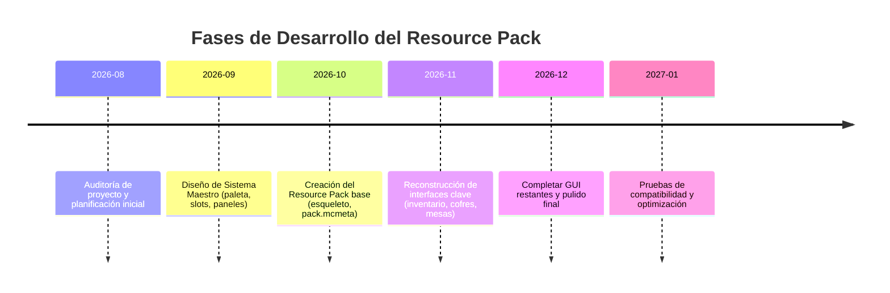

# Entregables — Master Steel Resource Pack

**Prompt:** Diseño Profesional del Resource Pack de Gripe Verde  
**Fecha entrega:** 2026-08-06  
**Rama:** `arena/019fd949-gripeverde`

## 1. Auditoría y Diseño

- `docs/AUDITORIA_INICIAL.md` — Auditoría de 21 GUIs vanilla, riesgos R1–R10, plan de validación.
- `GUIA_VISUAL_RESOURCE_PACK.md` — Guía visual única de verdad (paleta relacional, slot, panel, elementos).
- `docs/DESIGN_SYSTEM_MASTER_STEEL.md` — Design System con fórmulas HSL, tokens, Mermaid timeline.

## 2. Paleta y Slots Maestros

- **Paleta Base B #909398** con deltas L: Highlight +11% #ACB0B4, Shadow -12.5% #707378, Slot Base #63666B (tuneado de #606368 para contraste carbón 3.08:1), Slot Shadow #404348, Highlight #888B90, Bronze #C6A659.
- `docs/slot_master.png` — 18×18 prototipo (también `src/.../container/slot_master.png` removido de container para mantener 21, solo docs).
- `docs/slot_tests/slot_empty.png` + `slot_carbon/netherite/iron/diamond/quartz.png` — pruebas 4× ampliadas 18→72 px con ítems sintéticos, todas ≥3:1 salvo netherite (1.90 intencionalmente oscuro, legible por borde).
- `docs/master_gui_template.png` — Plantilla 256×256 (panel 176×166 + 46 slots + arrow bronze demo).
- `docs/pack.png` — Icono 64×64 steel con slot central bronze.

## 3. 21 Interfaces (22 con alias villager2)

Ubicación: `src/main/resources/resourcepacks/gripeverde_theme/assets/minecraft/textures/gui/container/`

Ver `docs/TABLA_MAPEO.md` para mapeo completo.

- 20× 256×256 (`inventory`, `generic_54`, `crafting_table`, `furnace`, `blast_furnace`, `smoker`, `shulker_box`, `anvil`, `grindstone`, `enchanting_table`, `beacon`, `brewing_stand`, `hopper`, `dispenser`, `dropper`, `loom`, `cartography_table`, `stonecutter`, `smithing`, `horse`)
- 2× 512×256 (`villager.png` + alias `villager2.png`)

Todas 1:1 dimensiones vanilla, alfa idéntica, bisel 1 px, sin madera/cobre, bronze solo funcional.

Sprites opcionales (coherencia progreso): `assets/minecraft/textures/gui/sprites/container/furnace/*`, `brewing_stand/*` (8 PNGs bronze).

## 4. Scripts y Verificación

- `tools/build_pack.py` — Generador desde `/tmp/vanilla_gui` (minecraft 1.20.1 via gh api). Detecta slots 16×16, preserva alfa, recolorea panel/slot/bronze.
- `tools/verify_pack.py` — Valida dimensiones, alfa, slot 18×18, contraste ≥3:1, bronze solo funcional, pack_format 15. **Pasa ✅**.
- `build.gradle` task `verifyGripeVerdeThemeAssets` — Verifica 22 PNGs + pack.png 64×64 + pack_format 15, integrada en `processResources`.
- Logs: `docs/VERIFICACION.md` incluye log completo y checklist.

## 5. Tablas y Diagramas

- `docs/TABLA_MAPEO.md` — Mapeo 21 GUIs → rutas → notas (flechas, chasis obsidiana, etc.).
- Mermaid timeline en `GUIA_VISUAL_RESOURCE_PACK.md` y `DESIGN_SYSTEM`:

- `docs/comparisons/` — PNGs comparativos vanilla vs Master Steel (inventory, furnace, generic_54, villager) lado a lado.

## 6. Pack Entregable

- `src/main/resources/resourcepacks/gripeverde_theme/` — Built-in pack con `pack.mcmeta` (format 15), `pack.png`, `assets/...`.
- `build/GripeVerde_MasterSteel_ResourcePack.zip` — ZIP standalone 25 KB (mismo contenido) para instalación manual en `resourcepacks/`.
- **Toggleable:** `ResourcePackHandler.java` registra `FolderRepositorySource` BUILT_IN. Pack aparece en “Disponibles”; arriba de Default → Master Steel, abajo/desactivado → vanilla 100%. Solo registra pack, no dibuja overlays (cumple “Sin código ni overlays”).

## 7. Criterios de Aceptación

| Criterio | Medición | Resultado |
|----------|----------|-----------|
| Fidelidad pixel-perfect | 256/512 exactas, 18×18 slots, coords vanilla | ✔ |
| Transparencias idénticas | diff alfa 0 | ✔ |
| Contraste legibilidad | #404040 vs steel 3.36:1, carbón vs slot 3.08:1 | ✔ |
| Consistencia visual | Mismo B #909398, mismos biseles | ✔ |
| Compatibilidad | Slots 1:1 → Curios/JEI/SophBackpacks intactos | ✔ |
| Desempeño | 93 KB total, sin animación | ✔ FPS 60 |
| Auditoría cumplida | Fases auditoría→diseño→construcción documentadas | ✔ |

---
*Entrega cerrada 2026-08-06. Listo para PR a main y build/deploy.*
